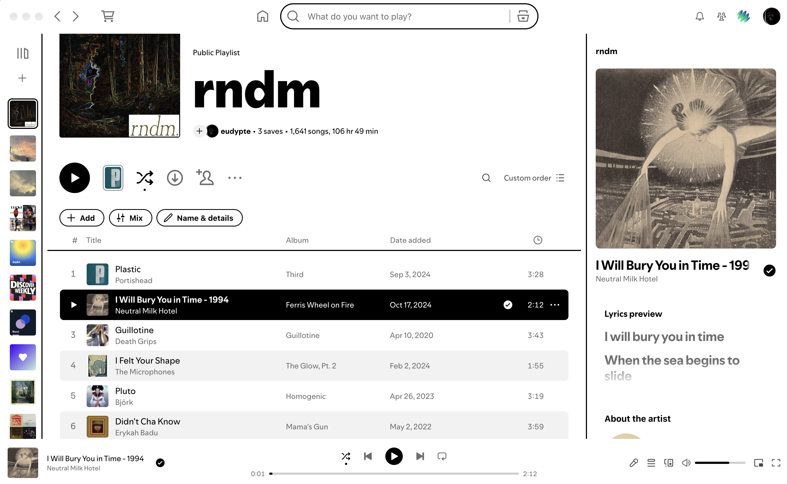

# Contrast

A high contrast light theme for Spotify. White surfaces, black borders between panes, no album-color glow.



## Install

### Marketplace
Search for **Contrast** in the Spicetify Marketplace Themes tab.

### Manual
```
git clone https://github.com/eudypte/spicetify-contrast ~/.config/spicetify/Themes/Contrast
spicetify config current_theme Contrast color_scheme base inject_css 1 replace_colors 1
spicetify apply
```

## Notes
- Built and tested on macOS. Uses the system font (SF Pro) with Helvetica Neue as fallback.
- Some selectors target Spotify's hashed class names. If the album-color glow returns after a Spotify update, open an issue with your Spotify version.

## Uninstall
```
spicetify config current_theme ""
spicetify apply
```
